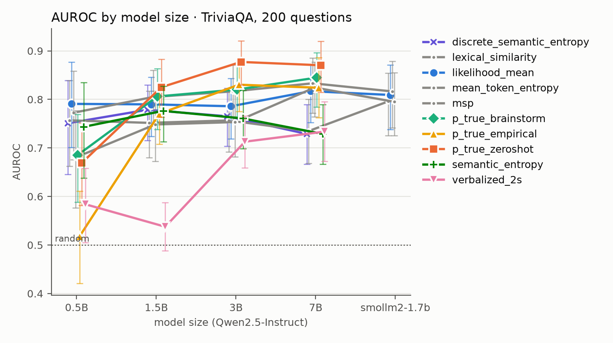

# LLM-probly

Which uncertainty method should you trust for *your* language model, and what does its score mean?
LLM-probly benchmarks uncertainty methods for LLM answers on top of
[probly](https://github.com/pwhofman/probly), picks the cheapest method that is not significantly worse
than the best one for each model, and calibrates its score into a confidence in [0, 1]. The result is
one profile per model (`profiles/<model>.json`) that an application reads, without running the benchmark
again.

<picture>
  <source srcset="demo/llm_uncertainty_demo_1.5b_200q_dark.svg" media="(prefers-color-scheme: dark)">
  <source srcset="demo/llm_uncertainty_demo_1.5b_200q_light.svg" media="(prefers-color-scheme: light)">
  
</picture>

## Quickstart

```bash
git clone git@github.com:elifkaracaa/probly.git
cd probly
uv sync
cd experiments/llm-probly
```

All commands below run from `experiments/llm-probly`.

**1. Look at the method chosen for a model** (no model download, reads the saved profile):

```bash
uv run python -m selector.profile profiles/qwen1.5b.json
```

**2. Run the whole pipeline on a few questions** (downloads Qwen2.5-0.5B-Instruct, about 1 GB, runs on a
laptop CPU): generate an answer, score it, read the profile and print a calibrated confidence.

```bash
uv run python ../../examples/llm_pipeline/llm_uncertainty_pipeline.py
```

**3. Reproduce a benchmark run** (generate, label, score with every method, evaluate). Steps that are
already done are skipped, so with the cached data in `data/` this only evaluates:

```bash
uv run python -m cli run --config configs/qwen1.5b_triviaqa_200.yaml
uv run python -m cli compare --dataset triviaqa --n 200
```

Plots and the full report over every run (Markdown + HTML, with cost and the cheapest method tied with
the best): `uv run python -m cli plot --dataset triviaqa --n 200` and `uv run python -m cli report`.

For long runs, keep the computer awake (macOS: put `caffeinate -i` in front of the command; Linux:
`systemd-inhibit`; Windows: the power settings). Generation saves after every question and resumes.

## Results

TriviaQA, 200 questions, Qwen2.5 0.5B to 7B. Full tables (AUROC, PRR, AURC, ECE, plus SmolLM2-1.7B):
[`results/comparison_triviaqa_200.md`](results/comparison_triviaqa_200.md).

**Method chosen per model** by the selector (calibration half of the questions; details in
[docs/selector.md](docs/selector.md)):

| model | accuracy | chosen method | why | calibration | held-out ECE |
|---|---|---|---|---|---|
| Qwen2.5-0.5B | 0.190 | likelihood_mean | tied with the best (eccentricity), 12x cheaper | Platt | 0.091 |
| Qwen2.5-1.5B | 0.375 | likelihood_mean | tied with the best (p_true_zeroshot), 2x cheaper | Platt | 0.095 |
| Qwen2.5-3B | 0.485 | p_true_zeroshot | best; every cheaper method is significantly worse | isotonic | 0.219 -> 0.103 |
| Qwen2.5-7B | 0.590 | mean_token_entropy | tied with the best (p_true_zeroshot), 2x cheaper | Platt | 0.126 |

Over 10 random calibration/held-out splits the selector is within ±0.01 AUROC of the best fixed method,
and about 0.05 better than the expensive semantic methods at a twelfth of the cost.

**AUROC per method** (higher is better, 0.5 = random; best per model in bold):

| method | family | 0.5B | 1.5B | 3B | 7B |
|---|---|---|---|---|---|
| p_true_zeroshot | self-eval | 0.669 | 0.825 | **0.877** | **0.870** |
| p_true_brainstorm | self-eval | 0.685 | 0.806 | 0.820 | 0.845 |
| p_true_empirical | self-eval | 0.512 | 0.765 | 0.830 | 0.824 |
| verbalized_2s | self-eval | 0.584 | 0.538 | 0.713 | 0.734 |
| semantic_entropy | agreement | 0.744 | 0.776 | 0.761 | 0.729 |
| discrete_semantic_entropy | agreement | 0.751 | 0.779 | 0.765 | 0.729 |
| lexical_similarity | agreement | 0.757 | 0.752 | 0.757 | 0.735 |
| likelihood_mean | baseline | **0.791** | 0.790 | 0.786 | 0.817 |
| mean_token_entropy | baseline | 0.773 | 0.805 | 0.817 | 0.833 |
| msp | baseline | 0.680 | 0.748 | 0.753 | 0.824 |
| cocoa_p_true | hybrid | 0.734 | **0.833** | 0.786 | 0.752 |
| cocoa_msp | hybrid | 0.715 | 0.759 | 0.737 | 0.733 |



**Takeaways**
1. Self-evaluation needs model size. Zero-shot p(True) goes 0.67 -> 0.83 -> 0.88 -> 0.87 (0.5B -> 7B) and
   is the best method from 1.5B on; at 0.5B every p(True) variant is worse than the cheap baselines.
2. Semantic entropy and its discrete version are almost identical (0.73-0.78) and do not grow with size:
   bigger models repeat their answers more often, so the samples also agree when the answer is wrong.
3. The cheap baselines need no extra model calls and get better with size; at 7B mean token entropy and
   MSP reach 0.82-0.83.
4. Verbalized confidence is weak with the original 0-100 prompt; an anchored 0-10 prompt raises it to
   0.644 (1.5B) and 0.804 (3B) ([docs/methods.md](docs/methods.md#verbalized-confidence-prompt)).
5. With 100 calibration questions most methods are statistically tied, so the selector mostly picks the
   cheapest good one.

Example of one certain and one uncertain answer (uncertainty rank: average over five methods of the
answer's rank among the 200 questions, 0 = most certain, 1 = most uncertain):

| question | answer | correct | uncertainty rank |
|---|---|---|---|
| In which year was Sputnik, the first man-made satellite, launched? | 1957. | yes | 0.11 |
| Who wrote the 1993 novel "The Joy Luck Club"? | Pu Songling | no (Amy Tan) | 0.93 |

The methods do not catch every wrong answer: some wrong answers are ranked as certain, and some right
answers as uncertain.

## Methods

`uv run python -m cli methods` lists every method with its family, the model access it needs and its cost.

| family | methods | needs |
|---|---|---|
| baseline | `likelihood_mean`, `mean_token_entropy`, `msp` | the greedy answer's token probabilities, no extra call |
| agreement | `semantic_entropy`, `discrete_semantic_entropy`, `lexical_similarity`, graph measures, cluster shares | 10 sampled answers (+ one shared NLI pass) |
| self-eval | `p_true_zeroshot`, `p_true_brainstorm`, `p_true_empirical`, `verbalized_2s` | one or more extra calls asking the model about its answer |
| hybrid | `cocoa_p_true`, `cocoa_msp` | a confidence score times the inconsistency of the samples |

Details: [docs/methods.md](docs/methods.md) (all methods, NLI setup, decisions),
[docs/semantic_methods.md](docs/semantic_methods.md) (user guide),
[docs/semantic_results.md](docs/semantic_results.md) (NLI cache, graph measures, results).

## Data

One cache per model and dataset, shared by every method:

```python
from common.data import load_data

rows = load_data("qwen1.5b", 200)
```

Fields per row: `id, dataset, question, aliases` (canonical answer first), `greedy_answer, greedy_ll_sum,
greedy_ll_mean, greedy_token_logprobs, greedy_token_entropies, samples` (10),
`samples_ll_mean, samples_ll_sum, model, correct_alias, correct, samples_correct`.
Settings and library versions of each run are in `data/<model>/<dataset>_<n>.meta.json`.

Re-create a cache (TriviaQA, temperature 0.7, max 32 new tokens, stop at the first newline, seed 42):

```bash
uv run python -m scripts.generate --model qwen1.5b --n 200
uv run python -m scripts.label    --model qwen1.5b --n 200
```

Accuracy per model and the label error rate: [docs/data_and_labelling.md](docs/data_and_labelling.md).
Every cached run (TriviaQA 200 / 1000, MMLU 200, five models incl. SmolLM2):
[docs/benchmark_caches.md](docs/benchmark_caches.md).

## How to add a method

1. Write one plugin file in `methods/`. It follows the score contract in [CONTRACT.md](CONTRACT.md): one
   uncertainty per question, higher = more uncertain.
2. Add one entry to `common/registry.py` with its family, access level and cost; `tests/test_registry.py`
   fails if the plugin and its entry disagree.
3. Add a test with a small fake row (no model download), like the existing tests in `tests/`.
4. Run it on a cached model and compare:
   `uv run python -m cli run --config configs/qwen1.5b_triviaqa_200.yaml --methods <name>`, then
   `uv run python -m cli compare --dataset triviaqa --n 200`.
5. Rerun the selector (`uv run python -m selector.select --save`) to see whether it changes a profile.

## More documentation

| page | what is in it |
|---|---|
| [docs/selector.md](docs/selector.md) | how the selector decides, the held-out check over 10 splits, stacking |
| [docs/pipeline.md](docs/pipeline.md) | configs, metrics (AUROC, AURC, PRR, ECE), plots, the report |
| [docs/data_and_labelling.md](docs/data_and_labelling.md), [docs/benchmark_caches.md](docs/benchmark_caches.md) | data, labels, every cached run |
| [docs/models_and_cost.md](docs/models_and_cost.md) | memory, seconds per question and the limits of a laptop |
| [CONTRACT.md](CONTRACT.md) | score contract, pipeline files, profile format |
| [demo/README.md](demo/README.md) | rebuilding the demo from the profiles |
| [POSITIONING.md](POSITIONING.md) | how LLM-probly compares to LM-Polygraph |
| [docs/decisions.md](docs/decisions.md) | scope and design decisions, with the PR behind each |
| [docs/names.md](docs/names.md) | glossary from the old team codes to descriptive names |

## Structure

```
cli.py        one entry point: run, methods, generate, label, compare, plot, report
common/       shared code: data, generation, correctness, evaluation, registry, NLI matrix
methods/      one plugin per uncertainty method (see CONTRACT.md)
selector/     method selector, calibration, stacking, held-out evaluation
profiles/     one selector profile per model, read by the API and the demo
demo/         demo builder and README animation
scripts/      generation, labelling, comparison, plots and analysis scripts
configs/      one YAML file per benchmark run
data/         cached answers per model and dataset, with their settings (.meta.json)
results/      score files, summaries, comparisons and plots
notebooks/    the week-1 notebooks per method (kept as a record)
docs/         detailed documentation
tests/        unit tests (uv run python -m pytest tests)
```

## Development

```bash
uv run python -m pytest tests       # experiment tests
uv run prek run --all-files         # from the repository root: ruff, ty and the other checks
```

Work on a branch and open a pull request into this fork's `main`
(`github.com/elifkaracaa/probly/compare/main...BRANCH`; the link git prints after a push may target
pwhofman/probly). Every pull request needs one approval and green checks before it is merged.
