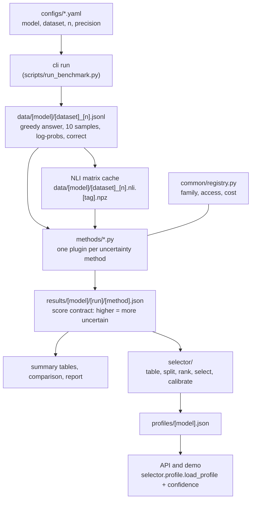

# Architecture overview

One page on how the pieces fit together. The goal of the project: for a given LLM, find the
cheapest uncertainty method that is not significantly worse than the best one, calibrate its score
into a confidence, and store the result in a per-model profile that an API or a demo can read.

## Data flow

Everything above the `profiles/` box runs offline on the benchmark. The API and the demo only read a
profile; they never run the selector.

## Layers

| Folder | What it holds | Depends on |
|---|---|---|
| `src/probly/representer/...` | library code we added to probly (semantic clusterer, self-evaluation representer) | probly only |
| `common/` | data loading, generation, labelling, metrics, the registry, the NLI matrix and its cache | `src/probly` |
| `methods/` | one file per uncertainty method; a method only needs `NAME` and `score()` | `common/` |
| `scripts/`, `cli.py` | commands that run the steps (generate, label, benchmark, report, plots) | `common/`, `methods/` |
| `selector/` | reads result files, chooses a method per model, calibrates, writes the profile | `common/` |
| `profiles/` | one JSON file per model, the selector's output | read by API and demo |

Rule: library code (`common/`, `methods/`, `selector/`) does not import from `scripts/`, so the layers only point downwards.

## The three contracts

1. **Score file** (`CONTRACT.md`): every method writes the same JSON record: question ids, one
   uncertainty per question (higher = more uncertain), a `failed` flag per question and the time per
   question. `common/io.py` validates it; a failed question gets uncertainty 1.0.
2. **Registry** (`common/registry.py`): family, access level (`text_only`, `logprobs`, `white_box`) and cost
   (generation passes per question) of every method. The runner, the summary table and the selector read
   this one table. `tests/test_registry.py` fails if a plugin and its entry disagree.
3. **Profile** (`CONTRACT.md`, `selector/profile.py`): the selector's result for one model. `save_profile`
   and `load_profile` check every rule, so a wrong file fails when it is written or read, not later in the API.

## What the selector does

It works on stored scores only and never loads a model:

1. `table`: load every method's scores and the correct/wrong labels of one model.
2. `split`: stratified split into a calibration part (100 questions) and a held-out part.
3. `rank`: AUROC and PRR with bootstrap intervals on the calibration part.
4. `select`: among the methods the user can run (access level, cost budget), take the best by AUROC, find
   the methods whose paired bootstrap difference to it contains 0, and choose the cheapest of those.
5. `calibrate`: fit a Platt or isotonic map on the calibration part (chosen by cross-validated Brier score);
   report ECE before and after on the held-out part.
6. `profile`: write `profiles/<model>.json`: the chosen method and why, its metrics on both parts, the
   calibration map and the metrics of every candidate.

Two more modules use the same functions but do not write a profile: `evaluate` compares the selector with every
fixed method on the held-out part, and `combine` compares a logistic-regression stack of all methods with the
best single method.

## Try it

    cd experiments/llm-probly
    uv run python -m cli methods --access text_only --max-cost 11   # the registry
    uv run python -m selector.select                                  # the choice for every model
    uv run python -m selector.profile profiles/qwen1.5b.json          # read one profile
